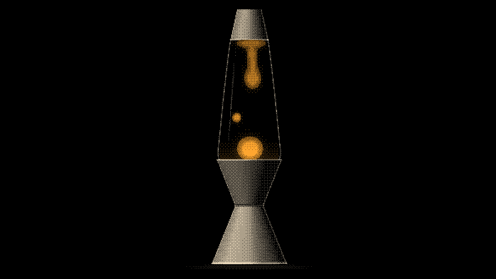
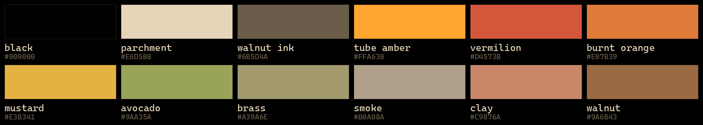

# Amber OLED

An [Omarchy](https://omarchy.org) theme for OLED panels. True black, a mid-century palette, and warm amber like tubes glowing in an old amp. Amber goes only on things that glow, so most of the screen stays dark and most of the pixels stay off.


```bash
omarchy-theme-install https://github.com/limehawk/omarchy-amber-oled-theme
```

## What's in it

- **108 wallpapers at 4K**, hand drawn in code as Bayer-dithered dots and ASCII glyphs, in parchment, walnut and amber on `#000000`.
- **A terminal palette to match**: parchment text, amber accent, and warm mid-century colours that keep diffs and errors readable.
- **An unlock screen**: a VU meter at rest, its pilot lamp lit.
- Every other app (Hyprland, the shell, btop, Neovim, VS Code, Chromium and the rest) is generated by Omarchy from one `colors.toml`.

## Wallpapers

The background picker walks through them by style, one highlight from each below. The lava lamp is the default.



Up close, at one screen pixel to one image pixel: the dither is the look. Fades break into single dots, so the grid and the gradient show at once.


### Lit objects

Hi-fi gear and atomic-age lamps, lit like solid things.


<details>
<summary>All 26 lit objects</summary>


</details>

### Line art

Starbursts, Sputniks and orbits in fine dotted strokes.


<details>
<summary>All 16 line art pieces</summary>


</details>

### Minimal

Mostly black. Knoxville at night: downtown and the Sunsphere across the river, and an Omarchy billboard lit up on the bluff.


<details>
<summary>All 19 minimal pieces</summary>


</details>

### Prints

Flat mid-century textile patterns.


<details>
<summary>All 28 prints</summary>


</details>

### ASCII

The same world in glyphs.


<details>
<summary>All 18 ASCII pieces</summary>


</details>

The thumbnails are shrunk, so they read darker than the real thing; open any file in [`backgrounds/`](backgrounds) for the full 3840 × 2160.

## Palette




| | |
|---|---|
| background | `#000000` |
| foreground | `#E6D5B8` parchment |
| accent | `#FFA630` tube amber |
| red / orange / yellow | `#D4573B` vermilion · `#E07B39` burnt orange · `#E3B341` mustard |
| green / cyan / blue | `#9AA35A` avocado · `#A39A6E` brass · `#B0A08A` smoke |
| magenta / brown | `#C9876A` clay · `#9A6B43` walnut |

Chromium-based browsers take Omarchy's pure-black seed. Chrome builds its own dark palette from it, so its frame is Chrome's darkest grey rather than true black; a browser theme can't go further.

## How it was made

Every wallpaper is drawn in code, dot by dot or glyph by glyph, and went through a trial sheet before it joined the set.

## Credits

The amber nods to [RetroPC](https://github.com/rondilley/omarchy-retropc-theme). The dithered style nods to Omarchy's Flexoki orb, and the ASCII to [Midnight](https://github.com/JaxonWright/omarchy-midnight-theme).

## License

MIT. See [`LICENSE`](LICENSE).
